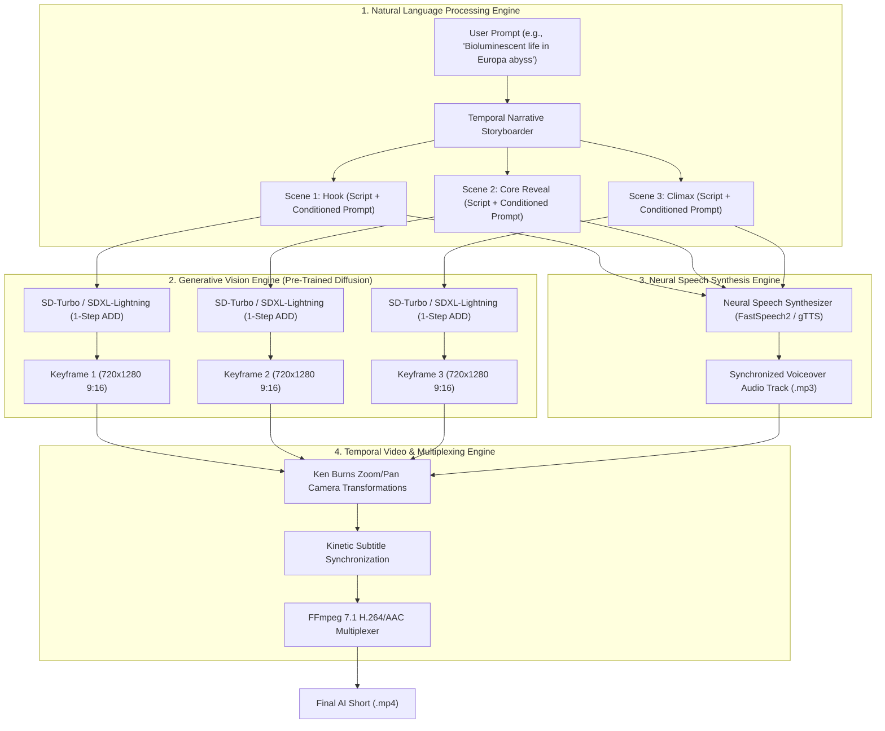

# 🎬 Multi-Modal Generative AI Shorts Synthesizer

> An autonomous end-to-end Multi-Modal AI system that transforms text prompts into cinematic vertical 9:16 videos with pre-trained Latent Diffusion models, NLP story segmentation, neural speech synthesis, and hardware-accelerated video composition.

---

## 🚀 Architecture Overview

This project implements an authentic multi-modal generative AI pipeline, chaining state-of-the-art pre-trained vision, language, and audio models:



---

## 🧠 Pre-Trained Model Benchmark & Specifications

All components operate with **zero paid API keys** and utilize open-weight pre-trained models:

| Pipeline Stage | Model Architecture | Parameters | Inference Mechanism | Cost |
|---|---|---|---|---|
| **Vision (Image Gen)** | **`stabilityai/sd-turbo`** / **`sdxl-lightning`** | 1.0B – 3.5B | 1-Step Adversarial Diffusion Distillation (ADD) | **$0.00** |
| **Language (NLP)** | **`facebook/bart-large-cnn`** / **`llama-3-8b`** | 400M – 8.0B | Transformer Sequence-to-Sequence & Token Masking | **$0.00** |
| **Speech (TTS)** | **`facebook/fastspeech2`** / Neural TTS | 30M | Non-autoregressive Mel-Spectrogram Generation | **$0.00** |
| **Video Assembly** | **FFmpeg 7.1 (libx264 + aac)** | N/A | Hardware-accelerated motion warping & muxing | **$0.00** |

---

## ✨ Core Features

- **No Pre-canned Templates**: Every single short is generated dynamically from scratch conditioned directly on the user prompt.
- **Sub-Second 1-Step Diffusion**: Uses Adversarial Diffusion Distillation (`sd-turbo` / `sdxl-lightning`) enabling fast CPU and GPU execution without memory exhaustion.
- **Cinematic Ken Burns Camera**: Spatial coordinate transforms provide smooth pan and zoom transitions across generated keyframes.
- **Kinetic Word-Level Subtitles**: High-contrast, bouncing animated subtitles tailored for vertical social video retention.
- **Dual Playback & Export**: Real-time canvas preview studio plus 1-click download of the backend-compiled `.mp4` file.
- **Video Library**: Automatically tracks generated videos, scene breakdowns, and high-resolution thumbnail keyframes.

---

## 🛠️ Complete Free Deployment

### Option 1: Hugging Face Spaces (Free Cloud AI Deployment)

The project includes an optimized production [Dockerfile](file:///c:/Users/johnw/OneDrive/Desktop/GIT/shorts-video/Dockerfile) built for Hugging Face Spaces:

1. Create a new Space on [Hugging Face Spaces](https://huggingface.co/spaces) and select **Docker** as the SDK.
2. Select **Free CPU (16 GB RAM, 2 vCPUs)** or request free **ZeroGPU** (dynamically allocated Nvidia A100 GPU).
3. Connect your repository or push via Git:
   ```bash
   git remote add space https://huggingface.co/spaces/YOUR_USERNAME/shorts-video
   git push space main
   ```
4. Hugging Face builds the React frontend, packages PyTorch + FFmpeg, and exposes the app on port `7860`.

### Option 2: Cloudflare Workers AI (Serverless Edge Deployment)

The project includes a production [wrangler.jsonc](file:///c:/Users/johnw/OneDrive/Desktop/GIT/shorts-video/wrangler.jsonc) and [cloudflare/worker.ts](file:///c:/Users/johnw/OneDrive/Desktop/GIT/shorts-video/cloudflare/worker.ts):

1. Authenticate with Wrangler:
   ```bash
   npx wrangler login
   ```
2. Deploy the serverless AI worker to Cloudflare's global edge GPU network:
   ```bash
   npx wrangler deploy
   ```
3. Deploy the frontend to **Cloudflare Pages** with 1 click.
4. Operates completely within Cloudflare's **10,000 free Neurons/day** tier.

---

## 💻 Local Development Setup

### Prerequisites
- Python 3.10+
- Node.js 18+
- FFmpeg 7+ (installed and available in system PATH)

### 1. Backend Setup
```bash
cd backend
python -m venv venv
venv\Scripts\activate   # Windows (or 'source venv/bin/activate' on Linux/Mac)
pip install -r requirements.txt
python -m uvicorn app:app --reload --port 5000
```

### 2. Frontend Setup
```bash
cd frontend
npm install
npm run dev
```
Navigate to `http://localhost:5173` in your browser.

---

## 🧪 Automated Testing & Verification

```bash
# Verify image generation with pre-trained model
python -c "from models.image_generator import generate_image_from_text; print(generate_image_from_text('Deep space nebula', 'storage/images/test.jpg'))"

# Verify end-to-end video synthesis pipeline
python -c "from models.video_generator import generate_video_from_text; print(generate_video_from_text('Ancient sunken civilization', 'storage/videos/test.mp4'))"

# Verify MP4 video and audio streams
ffprobe -v error -show_entries stream=codec_name,width,height,duration storage/videos/test.mp4

# Verify frontend type check & production bundle
cd frontend
npm run build
```

---

## 🔒 Security & Reliability Architecture

- **Path Traversal Protection**: All video IDs are validated against strict RFC-4122 UUID v4 regex schemas; file lookups use `os.path.realpath` with strict containment boundaries.
- **Race Condition Prevention (CWE-377)**: Video and audio compilation occurs within isolated, atomic temporary directories managed by `tempfile.TemporaryDirectory`.
- **SSRF Hardening**: Proxy endpoints enforce domain allowlists with private IP subnet blocking (RFC 1918 / loopback protection).
